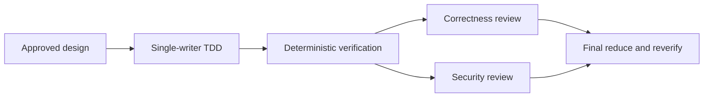

# Full-Property Mutation Oracle Implementation Plan

> **For agentic workers:** REQUIRED SUB-SKILL: Use superpowers:subagent-driven-development (recommended) or superpowers:executing-plans to implement this plan task-by-task. Steps use checkbox (`- [ ]`) syntax for tracking.

**Goal:** Add an opt-in mutation oracle that preserves the complete TLC configuration, classifies temporal counterexamples correctly, and emits reproducible digest-bound evidence without changing legacy state-invariant behavior.

**Architecture:** `OracleMode` selects either the existing transformed state-invariant configuration or an exact frozen cfg snapshot. TLC event interpretation moves into a focused classifier that returns an outcome and optional property name. Full-property reports add optional schema-v3 evidence objects while compatibility constructors and null omission preserve existing state-invariant JSON.

**Tech Stack:** Java 21, Gradle, JUnit 5, Jackson, picocli, TLC 1.8.0 tool events, rootless Podman sandbox tests.

---

## File Structure

- Create `src/main/java/dev/tlamutant/experiment/OracleMode.java` for CLI and runner mode selection.
- Create `src/main/java/dev/tlamutant/experiment/ExperimentInputIdentity.java` for the five digest-bound artifacts.
- Create `src/main/java/dev/tlamutant/experiment/MutationEvidence.java` for source range, patch, oracle, and execution evidence.
- Create `src/main/java/dev/tlamutant/experiment/FullPropertyConfig.java` for byte-exact cfg materialization.
- Create `src/main/java/dev/tlamutant/tlc/TlcOutcomeClassifier.java` for structured event classification and bounded property-name extraction.
- Modify `TlcExecution`, `OracleOutcome`, and `TlcRunner` to expose temporal findings.
- Modify `ExperimentReport`, `MutationResult`, and `ExperimentRunner` to emit schema-v3 full-property evidence while retaining compatibility constructors.
- Modify `Main`, `SandboxInput`, `PodmanCommand`, `CorpusExperimentRunner`, and `CorpusExperimentReport` to transport the explicit mode and manifest identity.
- Add unit tests beside each component and add real TLC fixtures under `src/testFixtures/resources/tla/full-property`.

### Task 1: Structured temporal outcome classification

**Files:**
- Create: `src/main/java/dev/tlamutant/tlc/TlcOutcomeClassifier.java`
- Modify: `src/main/java/dev/tlamutant/tlc/OracleOutcome.java`
- Modify: `src/main/java/dev/tlamutant/tlc/TlcExecution.java`
- Modify: `src/main/java/dev/tlamutant/tlc/TlcRunner.java`
- Create: `src/test/java/dev/tlamutant/tlc/TlcOutcomeClassifierTest.java`

- [ ] **Step 1: Write failing classification tests**

Cover event `2116` with `Temporal property Safe was violated`, generic `Temporal properties were violated`, exit code 13 without a violation event, timeout, OOM events `1001`/`1002`/`1003`, evaluation failures `2111`/`2113`, safety violations `2107`/`2108`/`2110`/`2112`, deadlock, complete success, and incomplete success. Verify invariant and action-property names are captured when their structured event bodies provide one.

```java
assertEquals(
        new TlcOutcomeClassifier.Classification(
                ExecutionStatus.COMPLETED, OracleOutcome.KILLED_TEMPORAL_NAMED, "Safe"),
        classifier.classify(true, 13, List.of(new TlcToolEvent(2116, 1, "Temporal property Safe was violated")), false));
assertEquals(
        OracleOutcome.NOT_EVALUATED,
        classifier.classify(true, 13, List.of(), false).oracle());
```

- [ ] **Step 2: Verify RED**

Run: `./gradlew test --tests dev.tlamutant.tlc.TlcOutcomeClassifierTest --console=plain`

Expected: compilation fails because `TlcOutcomeClassifier` and temporal enum values do not exist.

- [ ] **Step 3: Implement the minimal classifier**

Add `KILLED_TEMPORAL_NAMED` and `KILLED_TEMPORAL_GENERIC`. Interpret event codes in the precedence defined by the design. Extract names only from complete bounded event bodies using anchored patterns for TLC invariant, action-property, and temporal-property messages. Temporal names must match `[A-Za-z_][A-Za-z0-9_]{0,127}`; otherwise use the generic temporal outcome.

```java
record Classification(ExecutionStatus status, OracleOutcome oracle, String violatedProperty) {}
```

Keep exit code as a success precondition only; it is never a kill signal.

- [ ] **Step 4: Connect `TlcRunner` and verify GREEN**

Add `violatedProperty` to `TlcExecution` with an overload matching its old constructor, then delegate `TlcRunner` classification to the new class.

Run: `./gradlew test --tests dev.tlamutant.tlc.TlcOutcomeClassifierTest --tests dev.tlamutant.tlc.TlcToolEventParserTest --console=plain`

Expected: all selected tests pass.

- [ ] **Step 5: Commit**

```bash
git add src/main/java/dev/tlamutant/tlc src/test/java/dev/tlamutant/tlc
git commit -m "feat: classify temporal TLC violations"
```

### Task 2: Exact full-property configuration mode

**Files:**
- Create: `src/main/java/dev/tlamutant/experiment/OracleMode.java`
- Create: `src/main/java/dev/tlamutant/experiment/FullPropertyConfig.java`
- Create: `src/test/java/dev/tlamutant/experiment/FullPropertyConfigTest.java`
- Modify: `src/test/java/dev/tlamutant/experiment/StateInvariantConfigTest.java`

- [ ] **Step 1: Write the byte-preservation test**

Use a cfg containing comments, CRLF, `INVARIANTS`, and `PROPERTIES`. Assert that the produced file is byte-identical and that writing to an existing target fails closed.

```java
byte[] sourceBytes = "SPECIFICATION Spec\r\nINVARIANTS TypeOK Safe\r\nPROPERTIES Live\r\n".getBytes(UTF_8);
FullPropertyConfig.Materialized materialized = FullPropertyConfig.write(source, target);
assertArrayEquals(sourceBytes, Files.readAllBytes(target));
assertEquals(sha256(sourceBytes), materialized.artifact().sha256());
```

- [ ] **Step 2: Verify RED**

Run: `./gradlew test --tests dev.tlamutant.experiment.FullPropertyConfigTest --console=plain`

Expected: compilation fails because `FullPropertyConfig` does not exist.

- [ ] **Step 3: Implement exact snapshot materialization**

Read the cfg with `BoundedFileSnapshot`, write its bytes with `CREATE_NEW`, and return both the target path and digest identity. Use a bounded maximum consistent with existing manifest/config inputs.

- [ ] **Step 4: Verify GREEN and legacy behavior**

Run: `./gradlew test --tests dev.tlamutant.experiment.FullPropertyConfigTest --tests dev.tlamutant.experiment.StateInvariantConfigTest --console=plain`

Expected: both test classes pass.

- [ ] **Step 5: Commit**

```bash
git add src/main/java/dev/tlamutant/experiment/OracleMode.java src/main/java/dev/tlamutant/experiment/FullPropertyConfig.java src/test/java/dev/tlamutant/experiment/FullPropertyConfigTest.java src/test/java/dev/tlamutant/experiment/StateInvariantConfigTest.java
git commit -m "feat: preserve full TLC configuration"
```

### Task 3: Reproducible mutation and provenance evidence

**Files:**
- Create: `src/main/java/dev/tlamutant/experiment/ExperimentInputIdentity.java`
- Create: `src/main/java/dev/tlamutant/experiment/MutationEvidence.java`
- Modify: `src/main/java/dev/tlamutant/experiment/ExperimentReport.java`
- Modify: `src/main/java/dev/tlamutant/experiment/MutationResult.java`
- Create: `src/test/java/dev/tlamutant/experiment/MutationEvidenceTest.java`
- Modify: `src/test/java/dev/tlamutant/report/ReportWriterTest.java`

- [ ] **Step 1: Write failing evidence validation and patch tests**

Require five nonempty artifact identities, lowercase SHA-256, positive sizes, ordered UTF-16 offsets, a matching expected slice, and digest verification before and after patch application.

```java
MutationEvidence evidence = MutationEvidence.create(candidate, originalDocument, patchedDocument, execution);
assertEquals(originalDocument.content(), evidence.patch().reverse(patchedDocument.content()));
assertThrows(IllegalArgumentException.class, () -> evidence.patch().apply("changed source"));
```

Also serialize a legacy report and assert that `oracleMode`, `inputs`, and `evidence` are absent rather than serialized as null.

- [ ] **Step 2: Verify RED**

Run: `./gradlew test --tests dev.tlamutant.experiment.MutationEvidenceTest --tests dev.tlamutant.report.ReportWriterTest --console=plain`

Expected: compilation fails because the evidence records and report fields do not exist.

- [ ] **Step 3: Implement immutable evidence records**

Use nested records for `Artifact`, `SourceRange`, and `Patch`. Compute source digests from canonical UTF-8 bytes. Store the mutation module, definition, original/replacement text, optional violated property, TLC exit code, and distinct sorted error event codes. Patch application must verify source digest and expected source slice before replacement and verify the resulting digest afterward.

- [ ] **Step 4: Extend reports compatibly**

Add nullable full-property fields annotated with `@JsonInclude(JsonInclude.Include.NON_NULL)` and retain the existing public constructors. Full-property construction uses schema version 3 and nonnull `oracleMode`, `inputs`, and mutation evidence.

- [ ] **Step 5: Verify GREEN**

Run: `./gradlew test --tests dev.tlamutant.experiment.MutationEvidenceTest --tests dev.tlamutant.report.ReportWriterTest --console=plain`

Expected: selected tests pass and legacy JSON omits the additive fields.

- [ ] **Step 6: Commit**

```bash
git add src/main/java/dev/tlamutant/experiment src/test/java/dev/tlamutant/experiment src/test/java/dev/tlamutant/report/ReportWriterTest.java
git commit -m "feat: record reproducible mutation evidence"
```

### Task 4: Full-property experiment execution

**Files:**
- Modify: `src/main/java/dev/tlamutant/experiment/ExperimentRunner.java`
- Create: `src/test/java/dev/tlamutant/experiment/ExperimentRunnerFullPropertyTest.java`

- [ ] **Step 1: Write failing runner tests**

Use a real fake-Java process or a small injected execution seam, not a mock. Verify that the same exact cfg snapshot is supplied to baseline and mutants, a temporal kill receives verdict `full-property-temporal-kill`, tool failures remain `unresolved`, a temporal baseline aborts, and every result contains patch evidence.

- [ ] **Step 2: Verify RED**

Run: `./gradlew test --tests dev.tlamutant.experiment.ExperimentRunnerFullPropertyTest --console=plain`

Expected: compilation fails because the full-property runner entry point does not exist.

- [ ] **Step 3: Add an explicit full-property entry point**

```java
public ExperimentReport runFullProperty(
        Path modelDirectory,
        String moduleFile,
        String configFile,
        Path resultDirectory,
        ExperimentInputIdentity inputs)
```

Copy the model's regular input files into a private frozen workspace, materialize the exact cfg once from captured bytes, require a passing baseline, and run every candidate from those frozen inputs. Classify state, temporal, deadlock, passed, and unresolved outcomes. Do not execute type-only or legacy attribution reruns in this mode.

- [ ] **Step 4: Verify GREEN and legacy runner tests**

Run: `./gradlew test --tests dev.tlamutant.experiment.ExperimentRunnerFullPropertyTest --tests 'dev.tlamutant.experiment.*' --console=plain`

Expected: selected experiment tests pass.

- [ ] **Step 5: Commit**

```bash
git add src/main/java/dev/tlamutant/experiment/ExperimentRunner.java src/test/java/dev/tlamutant/experiment/ExperimentRunnerFullPropertyTest.java
git commit -m "feat: execute full-property mutation experiments"
```

### Task 5: Direct CLI provenance contract

**Files:**
- Modify: `src/main/java/dev/tlamutant/cli/Main.java`
- Create: `src/test/java/dev/tlamutant/cli/ExperimentCommandTest.java`

- [ ] **Step 1: Write failing CLI validation tests**

Execute picocli in-process. Verify the default remains state-invariants, `full-property` requires `--manifest`, full-property rejects invariant replacement options, malformed mode is rejected, and state-invariant mode does not require a manifest.

- [ ] **Step 2: Verify RED**

Run: `./gradlew test --tests dev.tlamutant.cli.ExperimentCommandTest --console=plain`

Expected: assertions fail because `--oracle-mode` and `--manifest` are not implemented.

- [ ] **Step 3: Implement CLI mode and frozen identities**

Snapshot module, cfg, manifest, tools JAR, and application JAR before execution. Use `TemporaryFileSnapshot` for the JAR inputs and the full-property cfg bytes so the executed inputs are the recorded inputs. Route to `runFullProperty` only for the explicit mode.

- [ ] **Step 4: Verify GREEN**

Run: `./gradlew test --tests dev.tlamutant.cli.ExperimentCommandTest --console=plain`

Expected: selected CLI tests pass.

- [ ] **Step 5: Commit**

```bash
git add src/main/java/dev/tlamutant/cli/Main.java src/test/java/dev/tlamutant/cli/ExperimentCommandTest.java
git commit -m "feat: expose full-property experiment mode"
```

### Task 6: Corpus and sandbox propagation

**Files:**
- Modify: `src/main/java/dev/tlamutant/sandbox/SandboxInput.java`
- Modify: `src/main/java/dev/tlamutant/sandbox/PodmanCommand.java`
- Modify: `src/main/java/dev/tlamutant/experiment/CorpusExperimentRunner.java`
- Modify: `src/main/java/dev/tlamutant/experiment/CorpusExperimentReport.java`
- Modify: `src/main/java/dev/tlamutant/cli/Main.java`
- Modify: `src/test/java/dev/tlamutant/sandbox/PodmanCommandTest.java`
- Modify: `src/test/java/dev/tlamutant/experiment/CorpusExperimentReportTest.java`

- [ ] **Step 1: Write failing sandbox transport tests**

Verify that full-property input emits `--oracle-mode full-property` and a strictly encoded manifest artifact, emits no invariant replacement arguments, and rejects full-property mode without the manifest identity. Verify legacy commands remain byte-for-byte equivalent at the argument-list level.

- [ ] **Step 2: Verify RED**

Run: `./gradlew test --tests dev.tlamutant.sandbox.PodmanCommandTest --tests dev.tlamutant.experiment.CorpusExperimentReportTest --console=plain`

Expected: assertions fail because mode and provenance are not transported.

- [ ] **Step 3: Implement bounded metadata transport**

Add `OracleMode` and an optional manifest artifact to `SandboxInput`, retaining legacy factories. Encode the artifact as strict bounded JSON argv, never shell text. `CorpusExperimentRunner` receives the mode and common identities from `CorpusExperimentCommand` and supplies them to each sandbox run.

- [ ] **Step 4: Bind the outer corpus report**

Add optional common manifest/tools/application identity to schema version 2 of `CorpusExperimentReport`; retain schema version 1 and its constructor for state-invariant runs.

- [ ] **Step 5: Verify GREEN**

Run: `./gradlew test --tests dev.tlamutant.sandbox.PodmanCommandTest --tests dev.tlamutant.experiment.CorpusExperimentReportTest --console=plain`

Expected: selected tests pass.

- [ ] **Step 6: Commit**

```bash
git add src/main/java/dev/tlamutant/sandbox src/main/java/dev/tlamutant/experiment/CorpusExperimentRunner.java src/main/java/dev/tlamutant/experiment/CorpusExperimentReport.java src/main/java/dev/tlamutant/cli/Main.java src/test/java/dev/tlamutant/sandbox/PodmanCommandTest.java src/test/java/dev/tlamutant/experiment/CorpusExperimentReportTest.java
git commit -m "feat: propagate full-property corpus provenance"
```

### Task 7: Real TLC regression fixtures

**Files:**
- Create: `src/testFixtures/resources/tla/full-property/NamedTemporal.tla`
- Create: `src/testFixtures/resources/tla/full-property/NamedTemporal.cfg`
- Create: `src/testFixtures/resources/tla/full-property/GenericLiveness.tla`
- Create: `src/testFixtures/resources/tla/full-property/GenericLiveness.cfg`
- Modify: `src/integrationTest/java/dev/tlamutant/tlc/TlcRunnerIntegrationTest.java`
- Create: `src/integrationTest/java/dev/tlamutant/experiment/FullPropertyExperimentIntegrationTest.java`

- [ ] **Step 1: Add the fixtures and failing integration assertions**

The named fixture must produce a configured temporal-property violation while its state invariant passes. The liveness fixture must produce event 2116 without a safely extractable property name. The end-to-end fixture must include at least one generated GCD/BRL/UOI candidate killed only because the original `PROPERTY` remains enabled.

- [ ] **Step 2: Verify RED against the pre-feature behavior**

Run: `./gradlew integrationTest --tests 'dev.tlamutant.tlc.TlcRunnerIntegrationTest' --tests 'dev.tlamutant.experiment.FullPropertyExperimentIntegrationTest' --console=plain`

Expected: temporal executions are not classified as temporal kills or the full-property entry point is missing.

- [ ] **Step 3: Adjust only fixture semantics or minimal integration plumbing**

Do not weaken assertions. If TLC 1.8.0 does not include the name in event 2116, keep the real run generic and retain the focused named-event unit test as the named compatibility contract.

- [ ] **Step 4: Verify GREEN**

Run: `./gradlew integrationTest --tests 'dev.tlamutant.tlc.TlcRunnerIntegrationTest' --tests 'dev.tlamutant.experiment.FullPropertyExperimentIntegrationTest' --console=plain`

Expected: all selected integration tests pass.

- [ ] **Step 5: Commit**

```bash
git add src/testFixtures/resources/tla/full-property src/integrationTest/java/dev/tlamutant
git commit -m "test: cover full-property temporal kills"
```

### Task 8: Documentation, full verification, and independent review

**Files:**
- Modify: `README.md`
- Modify: `docs/superpowers/specs/2026-08-31-full-property-oracle-design.md`
- Create on main checkout: `docs.local/logs/2026-08-31/2026-08-31-NNN-full-property-oracle.md`

- [ ] **Step 1: Document invocation and evidence semantics**

Add direct and corpus examples, explain that state-invariants remains the default, list temporal outcomes, and document that infrastructure failures are `NOT_EVALUATED`.

- [ ] **Step 2: Update the coverage ledger**

Change each implemented obligation from `Planned` to `Covered`, `Covered with overlap`, or a precise debt state. Record the exact test mapping and any environment-dependent sandbox limitation.

- [ ] **Step 3: Run fresh verification**

```bash
./gradlew spotlessApply
./gradlew clean spotlessCheck test integrationTest verifyFrozenApplication --console=plain
./gradlew sandboxTest --console=plain
git diff --check
```

Expected: formatting, unit, integration, frozen-application verification, and sandbox tests pass. If Podman preflight remains unavailable, record the exact unchanged environment failure and do not claim sandbox success.

- [ ] **Step 4: Inspect lifecycle leaks**

Run `pgrep` with exact `comm` and arguments for any processes started by this task. Stop only verified task-owned PIDs. Confirm no `.tlc-run-*`, `.mutant-*`, container, or scratch-volume residue remains.

- [ ] **Step 5: Request clean-context correctness and security reviews**

Provide reviewers only the original requirements, acceptance criteria, base/head diff, relevant files, and fresh test results. The security report must use `Must Fix`, `Should Fix`, and `Notes`. Fix all correctness-critical issues and every `Must Fix`, then rerun affected and full verification.

- [ ] **Step 6: Commit final documentation and fixes**

```bash
git add README.md docs/superpowers/specs/2026-08-31-full-property-oracle-design.md
git commit -m "docs: document full-property oracle evidence"
```

## Agent DAG Decision

```json
{
  "subagent_decision": {
    "decision": "clean_context_review",
    "reason": "The implementation changes shared Java records and execution paths, so one writer avoids conflicts; independent correctness and security evidence is valuable at the final diff.",
    "coordination_cost": "low",
    "recommended_workflow": "agent_dag",
    "max_subagents": 2
  },
  "coordination_model": "generator_verifier",
  "policy": {
    "write_policy": "single-writer",
    "max_write_concurrency": 1,
    "require_approval_before_write": false,
    "evidence_required": true
  },
  "nodes": [
    {"id": "approved-design", "type": "input", "depends_on": []},
    {"id": "single-writer-tdd", "type": "write", "depends_on": ["approved-design"]},
    {"id": "deterministic-verification", "type": "verify", "depends_on": ["single-writer-tdd"]},
    {"id": "correctness-review", "type": "read_only", "depends_on": ["deterministic-verification"]},
    {"id": "security-review", "type": "read_only", "depends_on": ["deterministic-verification"]},
    {"id": "final-reduce", "type": "verify", "depends_on": ["correctness-review", "security-review"]}
  ]
}
```



The approved design is the write gate. No writer subagent is used. Validation is the Gradle verification sequence in Task 8 plus review closure with zero correctness-critical or security `Must Fix` findings.
